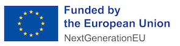

# The Swedish eIDAS Connector

---

The Swedish eIDAS Connector is an Open Source component, and is being used as an eIDAS connector for the Swedish participation of the [eIDAS federation](https://digital-strategy.ec.europa.eu/en/policies/eidas-regulation).

The Swedish eIDAS Connector is a [Spring Boot](https://spring.io/projects/spring-boot) application built on top of the [Spring Authentication Server](https://docs.swedenconnect.se/spring-authentication-server) library. It acts as a SAML Identity Provider in the [Sweden Connect](https://www.swedenconnect.se) federation, and as a SAML Service Provider against the eIDAS federation.

Go to <https://docs.swedenconnect.se/eidas-connector> for a set of resources for configuration, deployment and maintenance of the service.

Also, see the [Release Notes](https://docs.swedenconnect.se/eidas-connector/release-notes.html).

To test the connector locally against simulated foreign eIDAS nodes, see the [compose setup](compose/README.md) and the [eIDAS simulator](eidas-simulator/README.md).

---

Copyright &copy; 2017-2026, [Myndigheten för digital förvaltning - Swedish Agency for Digital Government (DIGG)](http://www.digg.se). Licensed under version 2.0 of the [Apache License](http://www.apache.org/licenses/LICENSE-2.0).

</img>
